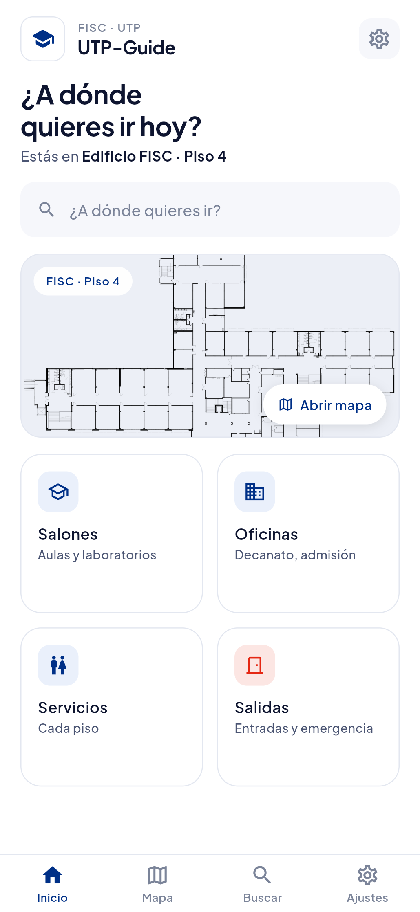
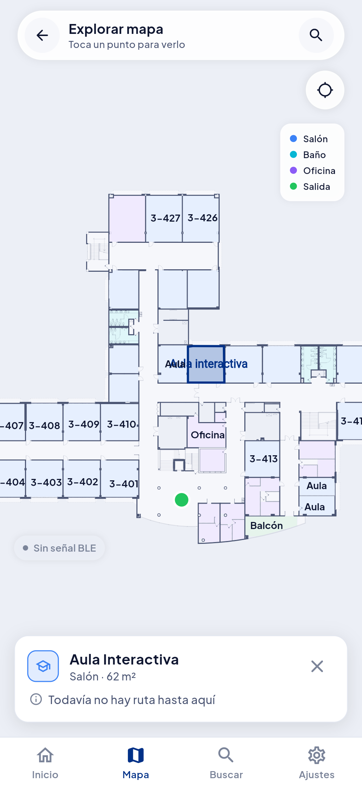
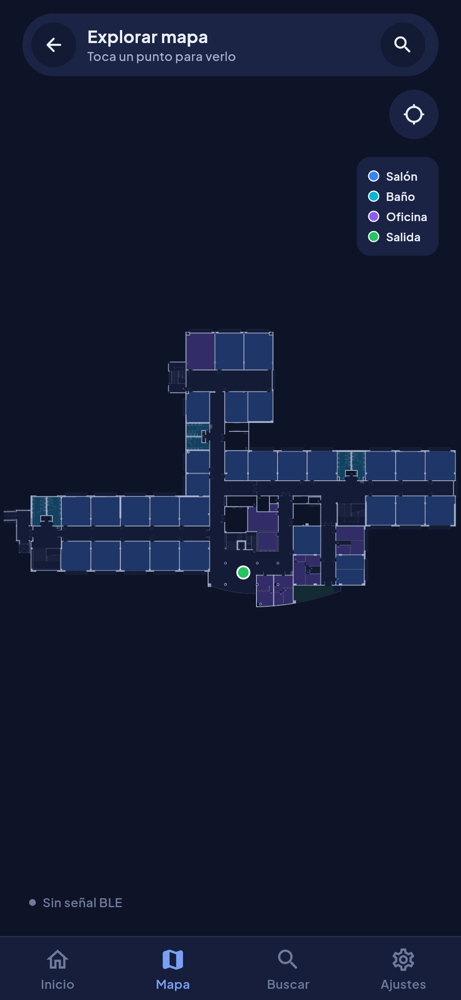

# UTP-Guide

**Navegación interior inclusiva para la Facultad de Ingeniería de Sistemas Computacionales (FISC)
de la Universidad Tecnológica de Panamá.**

[](https://github.com/hernansolano/utp-guide/actions/workflows/ci.yml)


UTP-Guide guía a una persona desde donde esté hasta un salón, baño, oficina o salida del edificio,
con un mapa del piso dibujado a escala real y rutas que pueden evitar escaleras. La posición del
usuario se estima con balizas Bluetooth (iBeacon) instaladas en el pasillo. El piloto es el
**piso 4 del edificio 3 de la FISC**.

<p align="center">
  
  &nbsp;
  
  &nbsp;
  
</p>

---

## Qué hace

- **Mapa del piso 4 a escala real** (127 × 79 m), generado a partir del plano arquitectónico
  oficial. Cada recinto es un polígono: se puede tocar, se resalta y muestra su tipo y su área.
- **Rutas con A\*** sobre un grafo de pasillos, con **perfil accesible** que descarta las aristas
  con escaleras antes de buscar el camino.
- **Posicionamiento BLE en tiempo real:** el punto azul se mueve con las lecturas de las balizas.
  Android usa `flutter_blue_plus`; en iOS los iBeacons se leen con Core Location, porque Apple no
  los entrega por Core Bluetooth.
- **Calibración en campo:** sliders en vivo para el modelo de propagación, estadísticas por baliza
  y medición del error contra la posición real.
- **Modo oscuro**, texto grande e indicaciones por voz.
- **Modo investigador** (oculto) para los experimentos de la Jornada de Iniciación Científica:
  caracterización del exponente de pérdida y comparación de filtros, con exportación a CSV.

## Cómo funciona el posicionamiento

```
RSSI de cada baliza ──► distancia ──► media móvil ──► centroide ponderado ──► snap al grafo ──► EMA ──► punto azul
                     d = 10^((Tx − RSSI) / 10n)   (8 lecturas)   (w = 1/d²)        (pull parcial)   (α = 0,35)
```

- Se descartan las lecturas imposibles (RSSI ≥ −20 dBm, que iOS reporta cuando la medición falla),
  las balizas de otro piso (`major`) y las que no están registradas.
- En el pasillo del piso 4 se midió **n ≈ 1,6 y TxPower ≈ −59 dBm**: el pasillo se comporta como
  guía de onda, muy lejos del n = 3–4 típico de interiores con concreto. Ver
  [ADR-0002](docs/adr/0002-parametros-path-loss.md).
- Todos los parámetros viven en `assets/data/beacon_config.json` y se ajustan sin recompilar.

Detalle completo en [docs/positioning-ble.md](docs/positioning-ble.md).

## Decisiones de diseño

Las decisiones importantes están documentadas como ADRs en [`docs/adr/`](docs/adr/README.md). Algunas:

| ADR | Decisión |
|-----|----------|
| [0001](docs/adr/0001-centroide-ponderado.md) | Centroide ponderado en vez de trilateración por mínimos cuadrados |
| [0003](docs/adr/0003-snap-to-graph-aristas.md) | Snap-to-graph sobre aristas, no sobre nodos |
| [0006](docs/adr/0006-formato-mapa-svg-metrico.md) | Mapas SVG a escala fija 100 px = 1 m |
| [0009](docs/adr/0009-pinning-dependencias.md) | Pin exacto y auditoría de paquetes con código nativo |
| [0013](docs/adr/0013-plano-oficial-recintos.md) | Plano oficial (PDF vectorial 1:250) → SVG + recintos interactivos |

## Ejecutar

```bash
git clone https://github.com/hernansolano/utp-guide.git
cd utp-guide
flutter pub get
flutter run            # en un teléfono Android o iPhone conectado
```

- El posicionamiento necesita un teléfono real y balizas configuradas según
  [docs/setup-beacons.md](docs/setup-beacons.md).
- `flutter run -d chrome` sirve para ver el mapa sin Bluetooth (las capturas de arriba salen de ahí).
- Para instalar en un iPhone sin Mac, ver [docs/instalar-en-iphone.md](docs/instalar-en-iphone.md).

### Tests

```bash
flutter analyze
flutter test
```

Hay tests del ruteo A\* (incluida la ruta accesible), de la validación del grafo, del
posicionamiento (filtros y centroide) y del plano de recintos. El CI los corre en cada push
(`.github/workflows/ci.yml`).

## Estructura

```
lib/
├── data/repositories/   # Carga y validación del grafo, las balizas y los recintos
├── models/              # Nodo, Arista, Position, Recinto, BeaconReading…
├── services/            # A*, BLE (Android / iOS), posicionamiento, voz
├── research/            # Modo investigador (experimentos)
└── ui/                  # Pantallas, MapView con cámara, painters del mapa
assets/
├── data/                # Entorno activo + entornos/ (piso 4, pasillo, aula)
└── maps/                # Planos SVG (100 px = 1 m)
tools/                   # Editor de grafo (CLI), extractor del plano oficial, editor HTML
docs/                    # Arquitectura, ADRs, formato de mapas, guías
```

## Estado y próximos pasos

| Fase | Estado |
|------|--------|
| 1 · Mapa 2D, A\*, perfiles de movilidad | ✅ Completa |
| 2 · Posicionamiento BLE | ✅ Implementada y calibrada en el pasillo norte |
| Plano oficial del piso 4 con recintos | ✅ Base lista; falta el grafo de pasillos y ubicar las balizas |
| 3 · Guía en realidad aumentada | ⏸️ Código conservado pero desactivado (`kArHabilitado = false`) |
| 4 · Accesibilidad avanzada (háptico, más voz) | 🔜 Planificada |

Lo pendiente está en [docs/roadmap.md](docs/roadmap.md).

## Tecnologías

Flutter / Dart · `flutter_blue_plus` · `dchs_flutter_beacon` (Core Location) · `flutter_svg` ·
`go_router` · `flutter_tts` · `permission_handler` · Python (extracción del plano oficial)

## Equipo

Desarrollado por:

- **Hernán Solano**: desarrollador; arquitectura, posicionamiento BLE y experimentos.
- **Paola Ran**: desarrolladora; concepto, investigación y pruebas.
- **Tiphany Díaz**: desarrolladora; concepto, investigación y pruebas.

Estudiantes de la Facultad de Ingeniería de Sistemas Computacionales, Universidad Tecnológica de
Panamá, en el marco del programa **SUCCESS** financiado por **Erasmus+** de la Unión Europea.

## Licencia

© 2026 Hernán Solano, Paola Ran y Tiphany Díaz (equipo UTP-Guide). Todos los derechos
reservados: el código se publica solo para consulta.
Ver [LICENSE](LICENSE).
